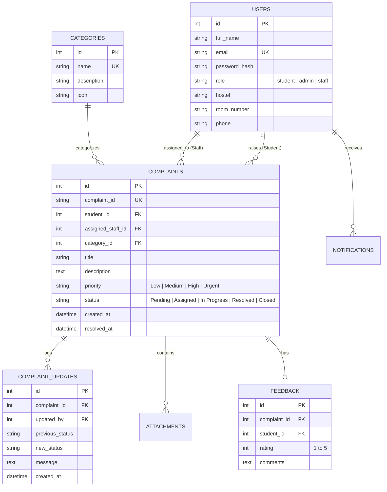

# 🏨 Hostel Help Desk Management System (HMS App)

[](https://fastapi.tiangolo.com)
[](https://nextjs.org)
[](https://react.dev)
[](https://www.typescriptlang.org)
[](https://tailwindcss.com)
[](https://www.sqlalchemy.org)
[](https://jwt.io)

---

## 📌 Overview

**Hostel Help Desk Management System (HMS App)** is an enterprise-grade, full-stack web application designed for university hostels and residential complexes. It streamlines the entire complaint lifecycle—from filing maintenance issues by students, intelligent ticket dispatching by wardens/admins, to real-time status resolution by field maintenance staff.

---

## ✨ Key Features

### 👨‍🎓 1. Student Portal
- **Complaint Submission:** Register issues with categorization (Electrical, Plumbing, Wi-Fi, Food/Mess, Cleaning, etc.), urgency/priority flags (Low, Medium, High, Urgent), and image attachments.
- **Real-Time Ticket Tracking:** Track live progress from `Pending` ➔ `Assigned` ➔ `In Progress` ➔ `Resolved` ➔ `Closed`.
- **Status Timelines:** View chronological audit trails and technician notes.
- **Rating & Feedback:** Submit star ratings (1–5) and review comments upon issue resolution.
- **In-App Notifications:** Instant alerts when tickets are assigned, updated, or marked resolved.

### 🛡️ 2. Admin & Warden Dashboard
- **Analytics & KPIs:** View total tickets, resolution rate, average turnaround time, active complaints, and category distribution charts (Recharts).
- **Automated / Manual Ticket Dispatch:** Assign complaints to designated staff (electricians, plumbers, carpenters, etc.).
- **Priority Escalations:** Filter and address urgent hostel grievances instantly.
- **Category & Staff Management:** Create/toggle maintenance categories and oversee technician workloads.
- **Audit Logs:** Exportable complaint history and accountability tracking.

### 🔧 3. Maintenance Staff Portal
- **Assigned Task Queue:** Dedicated mobile-responsive view of open job tickets.
- **Status Progression:** Update tickets to `In Progress` or `Resolved` with resolution messages.
- **Hostel & Room Navigation:** Direct visibility into student room number, block, and contact info.

---

## 🛠️ Technology Stack

| Layer | Technology | Description |
| :--- | :--- | :--- |
| **Frontend** | [Next.js 16 (App Router)](https://nextjs.org) | Modern React 19 framework with SSR/CSR hydration |
| **Styling** | [Tailwind CSS v4](https://tailwindcss.com) | Modern utility-first styling with sleek dark/light accents |
| **Icons & UI** | [Lucide React](https://lucide.dev) & [Framer Motion](https://www.framer.com/motion/) | Animated transitions & crisp vector iconography |
| **Charts** | [Recharts](https://recharts.org) | Dynamic responsive charts for administrative telemetry |
| **Backend** | [FastAPI](https://fastapi.tiangolo.com) (Python 3.10+) | High-performance asynchronous REST API framework |
| **ORM & DB** | [SQLAlchemy 2.0](https://www.sqlalchemy.org) + [SQLite](https://www.sqlite.org) | Robust ORM (can easily switch to PostgreSQL / MySQL) |
| **Security** | [Python-Jose](https://github.com/mpdavis/python-jose) + [Passlib](https://passlib.readthedocs.io) | JWT access token authentication with bcrypt password hashing |

---

## 🚀 Quick Start Guide

### Prerequisites
- **Node.js** (v18.x or higher) & **npm**
- **Python** (v3.10 or higher) & **pip**

---

### 1️⃣ Backend Setup

```bash
# Navigate to the backend directory
cd backend

# Create and activate a virtual environment
# On Windows:
python -m venv venv
.\venv\Scripts\activate
# On Linux/macOS:
# python3 -m venv venv
# source venv/bin/activate

# Install dependencies
pip install -r requirements.txt

# Seed the database with categories, admin, staff & student accounts
python seed.py

# Start the FastAPI server
uvicorn app.main:app --reload --port 8000
```
> 🌐 The Backend REST API will run at **http://localhost:8000**  
> 📑 Interactive Swagger API Documentation: **http://localhost:8000/docs**

---

### 2️⃣ Frontend Setup

```bash
# Navigate to the frontend directory
cd frontend

# Install Node modules
npm install

# Start the Next.js development server
npm run dev
```
> 💻 The Frontend web app will be live at **http://localhost:3000**

---

## 🔑 Demo Login Credentials

You can test all user roles immediately using the pre-seeded credentials:

| Role | Email | Password | Access Level |
| :--- | :--- | :--- | :--- |
| **👨‍🎓 Student** | `student@example.com` | `password123` | File complaints, track tickets, feedback |
| **🛡️ Admin / Warden** | `admin@example.com` | `password123` | Full control, assign tickets, view KPIs |
| **⚡ Electrician Staff** | `staff@example.com` | `password123` | View assigned electrical tasks, resolve tickets |
| **🚰 Plumber Staff** | `plumber@example.com` | `password123` | View assigned plumbing tasks, resolve tickets |

---

## 🗄️ Database Architecture



---

## 📂 Project Directory Structure

```text
HMS APP/
├── backend/
│   ├── app/
│   │   ├── api/             # API routes (auth, complaints, categories, admin, notifications)
│   │   ├── core/            # Configuration, database setup, JWT security
│   │   ├── models/          # SQLAlchemy ORM models
│   │   ├── schemas/         # Pydantic validation schemas
│   │   └── main.py          # FastAPI application entrypoint
│   ├── uploads/             # User uploaded complaint photos
│   ├── hostel_helpdesk.db   # SQLite local database
│   ├── seed.py              # Automated seed data generator
│   └── requirements.txt     # Python dependencies
│
└── frontend/
    ├── src/
    │   ├── app/
    │   │   ├── dashboard/
    │   │   │   ├── admin/     # Warden & Admin control panel
    │   │   │   ├── complaint/ # Detailed complaint timeline & discussion
    │   │   │   ├── staff/     # Technician / Staff task console
    │   │   │   └── student/   # Student complaint filing & tracking
    │   │   ├── login/         # Authentication (Sign In & Sign Up)
    │   │   ├── layout.tsx     # Global layout & notification providers
    │   │   └── page.tsx       # Landing page
    │   ├── components/        # Reusable UI components (Navbar, Modals, Badges)
    │   ├── context/           # Auth and Notification React context
    │   └── lib/               # Axios API client & utility helpers
    ├── package.json
    └── tailwind.config.ts
```

---

## 📡 Key REST API Endpoints

| Method | Endpoint | Description | Auth Required |
| :--- | :--- | :--- | :--- |
| `POST` | `/api/auth/register` | Register a new student/staff account | ❌ No |
| `POST` | `/api/auth/login` | Authenticate and obtain JWT bearer token | ❌ No |
| `GET` | `/api/auth/me` | Retrieve profile of authenticated user | ✅ Yes |
| `GET` | `/api/complaints` | List complaints (filtered by role & status) | ✅ Yes |
| `POST` | `/api/complaints` | Create a new complaint ticket with attachments | ✅ Student |
| `GET` | `/api/complaints/{id}` | Get complete complaint timeline & feedback | ✅ Yes |
| `PATCH` | `/api/complaints/{id}/status` | Update ticket progress & resolution message | ✅ Admin / Staff |
| `POST` | `/api/complaints/{id}/assign` | Assign ticket to maintenance personnel | ✅ Admin |
| `POST` | `/api/complaints/{id}/feedback` | Submit rating & comments for resolved ticket | ✅ Student |
| `GET` | `/api/admin/stats` | Retrieve aggregated dashboard KPIs & charts | ✅ Admin |
| `GET` | `/api/notifications` | Fetch unread notifications for current user | ✅ Yes |

---

## 🛡️ License

This project is open-source and available under the [MIT License](LICENSE).
